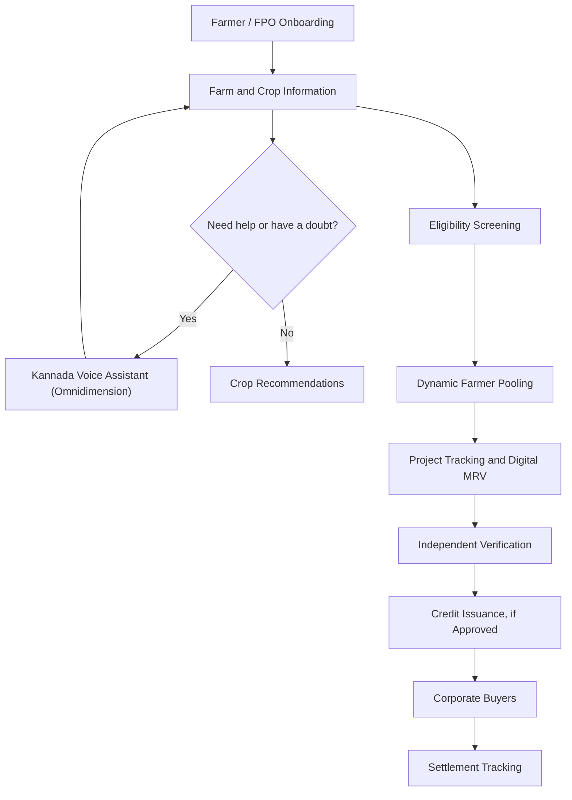

<div align="center">

# 🌱 ClimateCoins

### Connecting smallholder farmers to the carbon economy.

*A climate-tech platform for farmer aggregation, smarter crop decisions, and accessible agricultural carbon-project workflows.*


</div>

---

## 🌍 The Idea

Smallholder farmers can contribute to climate-positive agriculture, but accessing carbon markets, choosing suitable crops, and navigating digital services can be challenging.

**ClimateCoins brings these needs together** in a farmer-focused platform that supports FPO-led farmer aggregation, crop recommendations, Kannada voice assistance, and transparent agricultural carbon-project workflows.

## ✨ Key Features

### 🌾 Dynamic Farmer Pooling
Groups potentially eligible farmers into suitable project cohorts using farm and farmer information. Pooling can help coordinate project onboarding, monitoring, and documentation at scale.

### 🌱 Crop Recommendation
Helps farmers explore crop options based on available farm information and relevant growing conditions. Recommendations should be treated as decision support and validated against local agronomic guidance.

### 🎙️ Kannada Voice Assistant
Provides a more accessible way for Kannada-speaking farmers to interact with the platform through voice-based assistance, reducing reliance on text-heavy interfaces.

### 🛰️ Digital MRV Support
Organizes farm records, geospatial information, monitoring indicators, and project evidence to support measurement, reporting, and verification workflows.

### 🤝 Carbon Project Marketplace
Supports project discovery and helps connect eligible agricultural project supply with corporate buyer requirements.

### 💸 Transparent Project Tracking
Keeps project milestones, documentation, transaction status, and farmer-payout information easier to follow.

## 🔄 How It Works



## 🧰 Technology Stack

The repository includes a web portal and the project also uses Python for data-driven functionality. 
| Technology | Role |
|---|---|
| **React** | Interactive web interface and farmer-facing portal |
| **JavaScript / HTML / CSS** | Frontend interactions, structure, and styling |
| **Node.js + Express** | Backend API and application workflows |
| **SQLite** | Relational data storage for the portal prototype |
| **Python** | Crop recommendation, data processing, and ML-oriented functionality |
| **Omnidimension** | Kannada voice assistant for farmers and FPOs to ask questions and receive voice-based assistance |
| **GIS / satellite data sources** | Intended support for geospatial context and digital MRV, subject to integration |

### Feature-to-technology mapping

- **Dynamic farmer pooling:** Python for data processing and grouping logic; backend APIs for exchanging farmer/project data with the portal.
- **Crop recommendation:** Python for recommendation logic and any model/data processing; frontend components for displaying suggestions.
- **Kannada voice assistant:** Omnidimension powers the voice-assistant experience, helping farmers and FPOs ask questions and get assistance in Kannada.
- **Farmer and FPO portal:** React, JavaScript, Node.js/Express, and SQLite in the portal implementation.
- **Digital MRV and marketplace workflows:** Web application and backend modules, with GIS, satellite, verification, and buyer integrations added where available.

> **Stack accuracy note:** React, Express, SQLite, and Python as listed.

## 🚀 Getting Started

Clone the repository:

```bash
git clone https://github.com/AnshulGadgoli/climatecoins.git
cd climatecoins
```

Find the relevant application folder containing `package.json`, then install dependencies there:

```bash
npm install
```

Run the development script if the package defines one:

```bash
npm run dev
```

For Python components, use the Python version and dependencies specified by that component's setup files. If there is a `requirements.txt`, create and activate a virtual environment before installing:

```bash
python -m venv .venv
# Windows PowerShell
.venv\Scripts\Activate.ps1
pip install -r requirements.txt
```

The exact commands may differ if the frontend, backend, and Python services are in separate folders. Check each component's README and configuration files.

## 🌱 Impact Goals

- **SDG 1 — No Poverty:** Help expand farmer income opportunities.
- **SDG 2 — Zero Hunger:** Support informed, sustainable crop choices.
- **SDG 8 — Decent Work and Economic Growth:** Strengthen rural economic participation.
- **SDG 13 — Climate Action:** Support eligible agricultural carbon projects.
- **SDG 15 — Life on Land:** Encourage suitable soil-health, agroforestry, and restoration practices.

## 🧭 Roadmap

- [ ] Improve dynamic farmer pooling and explainability
- [ ] Validate crop recommendations with local agronomic data
- [ ] Improve Kannada voice interaction and accessibility
- [ ] Strengthen farmer consent, privacy, and role-based access
- [ ] Expand digital MRV evidence and project tracking
- [ ] Improve buyer discovery and settlement audit trails
- [ ] Test workflows with farmers, FPOs, and domain experts

## 📚 References

- [TIST — Farmer Carbon Model](https://program.tist.org)
- [Ecosystem Marketplace — State of the Voluntary Carbon Market 2025](https://www.ecosystemmarketplace.com/publications/2025-state-of-the-voluntary-carbon-market-sovcm/)
- [Verra — VM0042 Improved Agricultural Land Management](https://verra.org/methodologies/vm0042-improved-agricultural-land-management-v2-2/)

## ⚖️ Important Note

ClimateCoins is a project prototype. Crop suggestions and farmer-pooling results are decision-support outputs, not guarantees. Monitoring data, satellite indicators, and AI estimates do not independently certify carbon outcomes. Carbon-credit validation, verification, and issuance depend on the applicable standard, authorized program, and independent review. Some integrations may be planned or under development.

---

<div align="center">

**🌾 Making climate-project participation more accessible, inclusive, and transparent.**

</div>
